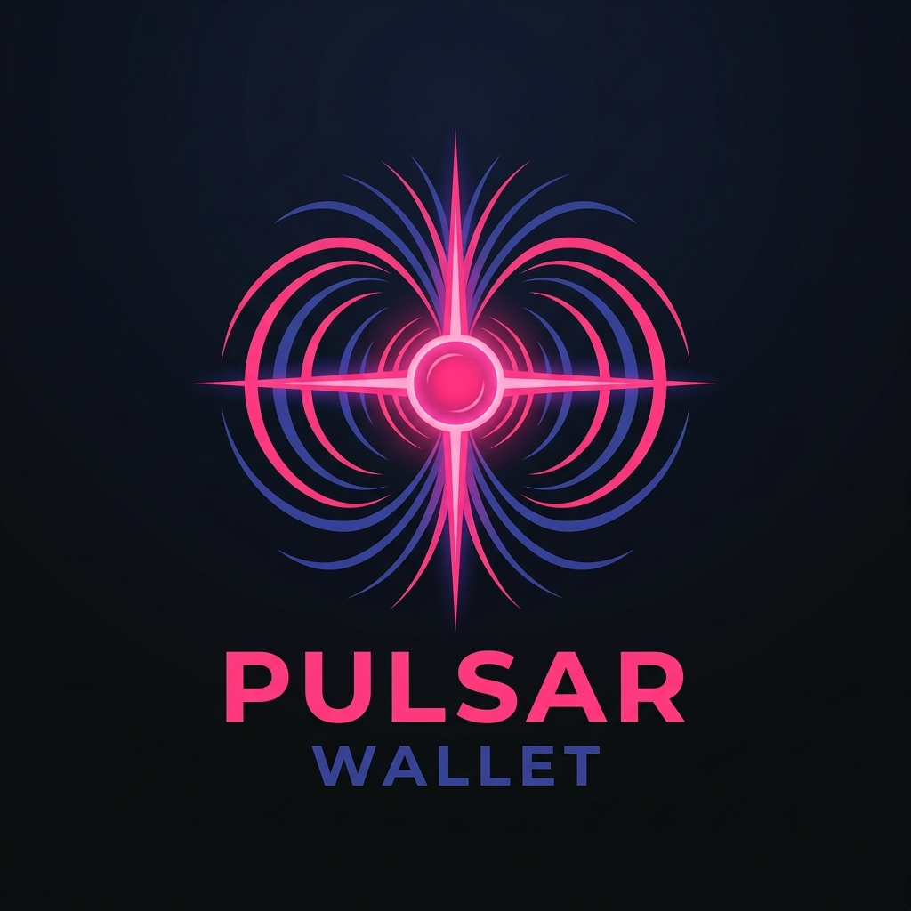

<p align="center">
  
</p>

# Pulsar Wallet

> **Pulsar Wallet** – the “MetaMask for Stellar.”  A secure, self‑custodial Chrome extension that makes it easy to store, send, receive, swap, and interact with Stellar assets and dApps.

---

## 1. Why Pulsar?

- **Self‑custodial** – you own the keys, no custodial services.
- **Chrome‑extension first** – no local node, no CLI – just a lightweight browser app.
- **Stellar‑centric** – supports XLM, SPL‑tokens, and the full Stellar SDK.
- **Zero‑friction dApp experience** – automatic injection of a JSON‑RPC provider like any other wallet.

---

## 2. Quickstart

```bash
# 1️⃣  Clone the repo
git clone https://github.com/your-org/pulsar-wallet
cd pulsar-wallet

# 2️⃣  Install dependencies
npm install

# 3️⃣  Run the Vite dev server (auto‑reload on changes)
npm run dev

# 4️⃣  In another terminal, build the Chrome extension
npm run build
```

Open Chrome → **Extensions** → **Load unpacked** → `frontend/dist`.  You can now use the extension.

---

## 3. Folder Layout

```
frontend/      # Chrome extension source
├─ src/        # React + TS
│   ├─ popup/   # Popup UI
│   ├─ siterext/ # Content script injection (future work)
│   ├─ background/packages/  # Background script
│   ├─ stores/  # Zustand stores
│   ├─ crypto/  # Key management + crypto helpers
│   └─ App.tsx   # Root component
├─ public/     # Manifest, icons, public assets
├─ tests/
│   ├─ unit/
│   └─ e2e/
├─ vite.config.ts
└─ package.json

contracts/     # Placeholder for future contract dev (if any)
backend/       # Placeholder for server logic if needed
```

---

## 4. Core Features

| Feature | Status | Notes |
|--------|--------|-------|
| Create / import wallet | ✔️ | Mnemonic + HD deriv thrott (stellar-hd-wallet) |
| View balances (XLM + assets) | ✔️ | Uses Stellar Horizon RPC |
| Send / receive assets | ✔️ | UTXO‑style metadata & ADA‑style fee |
| Transaction history | ✔️ | Persist टाइम in Chrome storage |
| dApp connection (Web3‑like) | ❓ | Pending – plan to expose `window.stellar` provider |
| Asset swap (via external DEX) | ❓ | TBD |

---

## 5. Development

### 5.1. Install the requested toolchain

```bash
# Node v20+ is required
node -v

# Install dependencies
npm install
```

### 5.2. Run & watch

```bash
# Vite dev server + hot‑module replacement
npm runप्रदेश

# Compile the extension (vite build + zip for Chrome)
npm run build
```

### 5.3. Testing

 gosh
```bash
# Unit tests (Vitest)
npm run test

# Watch mode
npm run test:watch

# End‑to‑end (Playwright)
npm run test:e2e
```

**Note:** E2E is currently a placeholder; you’ll need to wire up the Playwright config with a manifest injection.

### 5.4. Lint & formatting

```bash
npm run lint          # ESLint + TypeScript type‑checking
npm run format        # Prettier
```

---

## 6. Contribution Guidelines

1. **Fork** the repo and create a feature branch.  
2. Write clear, short commit messages.  
3. Ensure all tests pass (`npm run test`).  
4. Submit a PR with an English description of the change.  

We welcome issues, feature requests, and PRs that improve security, UX, or add new Stellar features.

---

## 7. Project Roadmapത്തിലുള്ള

| Version | Milestone |
|--------|-----------|
| v1.0 | Wallet creation, XLM send/receive, asset list, transaction history |
| v1.5 | dApp injection, transaction signing, WalletKit compatibility |
| v2.0 | Asset swap, hardware‑wallet pairing, NFT support, address book |
| v3.0 | Multi‑chain bridge, mobile companion, staking (if ecosystem supports) |

---

## 8. License

MIT © 2024 Pulsar Wallet contributors

---

## 9. Q&A & Support

- ❤️ Want to chat? Join our [Discord](https://discord.gg/pulsar-wallet) or open an issue.  
- Documentation in `IMPLEMENTATION.md` covers deeper design decisions and architecture.  

Thank you for using Pulsar Wallet – *Your gateway to the Stellar ecosystem!*